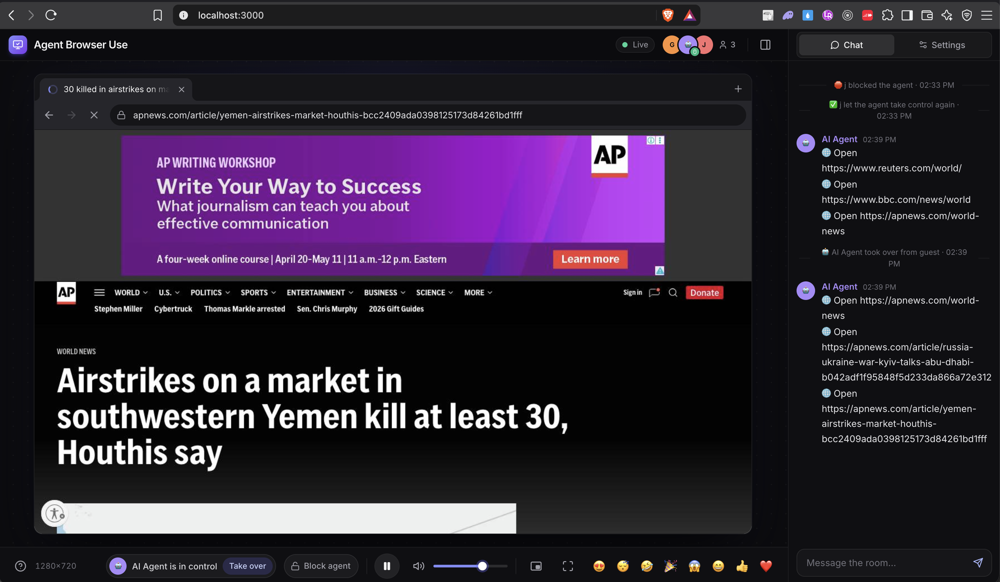

# Agent Browser Use

**Let AI coding agents drive a real browser over MCP, while you watch every step live in a web page and can take over at any time.**

Agent Browser Use is a single Go binary that runs one headless Chrome on your machine and exposes it as a set of
[Model Context Protocol](https://modelcontextprotocol.io) tools in the style of Playwright MCP. Any MCP-capable agent
(Claude Code, Codex, OpenCode, Pi, Cursor, VS Code…) can navigate, read the page, click, type and log in for you, while
a web viewer shows the agent's cursor, the element it is acting on, and a log of every step.



## Features

- **Playwright-style MCP tools** — `browser_snapshot` returns an accessibility outline with a `ref` for every element, and the action tools (click, type, scroll, drag, select…) use those refs.
- **Live viewer** — watch the page stream in your browser, with the agent's cursor, captions and chat log.
- **Shared browser room** — you and the agent use the same Chrome; take control at any time, or block the agent.
- **Persistent logins** — cookies live in a profile folder, so you sign in once and the agent reuses the session.
- **No heavy dependencies** — no Docker, X server or video encoder needed. Docker is available if you prefer it.

## Quick start

1. Download the project and start the server (requires Go 1.22+ and Chrome/Chromium, or just Docker):

   ```sh
   git clone https://github.com/cavaldos/agent-browser-use.git
   cd agent-browser-use
   make run            # starts the server on port 3000
   ```

   Or run it with Docker: `make docker`.

2. The server listens on **port 3000**:
   - Viewer (watch the agent): **http://localhost:3000**
   - MCP endpoint (connect agents): **http://localhost:3000/mcp**

Keep the server running while you use your agents. Other commands: `make build` (builds `bin/agent-browser-use`),
`make docker-logs`, `make docker-stop`. Options: `PORT=8080`, `HOST=0.0.0.0`, `ARGS="-agent-speed 1"`.

## Connecting a coding agent (MCP)

Once the server is running on port 3000, point your agent at `http://localhost:3000/mcp`.

### Claude Code

```sh
claude mcp add --transport http agent-browser http://localhost:3000/mcp
```

To share the setup with a team, put it in a project `.mcp.json`:

```json
{
  "mcpServers": {
    "agent-browser": {
      "type": "http",
      "url": "http://localhost:3000/mcp"
    }
  }
}
```

Check it with `claude mcp list` or `/mcp` inside Claude Code.

### Codex (OpenAI)

Codex reads MCP servers from `~/.codex/config.toml` (or `.codex/config.toml` in a trusted project):

```toml
[mcp_servers.agent-browser]
url = "http://localhost:3000/mcp"
```

Restart Codex after editing the file.

### OpenCode

OpenCode reads MCP servers from the `mcp` key of `opencode.json` (in the project root, or in the global config):

```json
{
  "$schema": "https://opencode.ai/config.json",
  "mcp": {
    "agent-browser": {
      "type": "remote",
      "url": "http://localhost:3000/mcp",
      "enabled": true
    }
  }
}
```

### Pi

Pi's MCP support depends on the version you use: MCP is not part of every Pi install, and it is often added through an
extension such as the community `pi-mcp-adapter`. Check the Pi documentation for your version. Once MCP is enabled,
register the server with the URL `http://localhost:3000/mcp`. With the common `mcpServers` JSON format used by most adapters:

```json
{
  "mcpServers": {
    "agent-browser": {
      "type": "http",
      "url": "http://localhost:3000/mcp"
    }
  }
}
```

### Other clients (Cursor, Claude Desktop, VS Code, …)

Most clients accept the same `mcpServers` JSON as above, for example `~/.cursor/mcp.json`. VS Code uses a `"servers"`
key and needs `"type": "http"`. Claude Desktop's config file only accepts stdio servers, so use a remote-MCP bridge
such as `mcp-remote` to connect it to `http://localhost:3000/mcp`.

### Verify the connection

Ask your agent something like:

> Go to news.ycombinator.com, open the top story and summarize it.

Then open **http://localhost:3000** to watch the agent work.

## Available tools

| Tool | What it does |
|---|---|
| `browser_navigate` / `browser_navigate_back` / `browser_navigate_forward` / `browser_reload` | Open a URL (non-URL text is searched on Google), or move through history |
| `browser_snapshot` | Accessibility outline of the page, with a `ref` for each actionable element |
| `browser_click` / `browser_hover` / `browser_type` / `browser_press_key` | Click, hover, type into a field, press keys and shortcuts |
| `browser_select_option` / `browser_scroll` / `browser_drag` | Pick `<select>` options, scroll, drag and drop |
| `browser_wait_for` / `browser_wait_for_change` | Wait for text, or for the page to change on its own |
| `browser_take_screenshot` / `browser_evaluate` | Screenshot the tab, or run JavaScript in the page |
| `browser_tabs` / `browser_say` | Manage tabs, or show a message to the people watching |
| `browser_console_messages` / `browser_network_requests` | Console output, exceptions and network requests (status, headers, response body). Action results also list new console errors and failed requests |
| `browser_downloads` / `browser_file_upload` | Wait for and read downloaded files; fill `<input type=file>` from the upload folder |
| `browser_cookies` / `browser_storage` / `browser_state` | Read and change cookies and localStorage/sessionStorage; save and restore a whole login session by name |
| `browser_snapshot_diff` | Only what changed on the page since the last snapshot or a named baseline |
| `browser_emulate` | Phone/tablet presets, screen size, pixel ratio, touch, user agent, locale, time zone, dark mode, GPS location, network speed |

See [docs/GUIDE.md](docs/GUIDE.md) for the full tool reference, options, the shared browser room, security and limitations.

## Options

```sh
make run ARGS="-port 8080"            # another port (then use http://localhost:8080/mcp)
make run ARGS="-agent-speed 1"        # slow the agent's cursor and typing so people can follow
make run ARGS="-mcp-remote"           # allow other machines on your LAN to call /mcp
make run ARGS="-no-mcp"               # disable /mcp, use only as a shared browser room
./bin/agent-browser-use -h            # all options
```

## Security

- Uploads only read from the upload folder (and the download folder), never from other places on the machine. Saved sessions (`states/`) contain cookies: treat them like passwords.
- The shared browser keeps the cookies of every account you log into. The agent can read any open page and run JavaScript in it, so only log into accounts you are happy for the agent to use.
- By default `/mcp` only accepts connections from the local machine, and it rejects requests from other websites.
- Anyone who can reach port 3000 can open the viewer and drive the browser. Keep it on a trusted network.

## Project layout

```
app/        Go source (MCP server, browser control, agent, web UI in static/)
docker/     Dockerfile and entrypoint
scripts/    run / build / docker scripts
docs/       full guide and images
bin/        built binary (make build)
```

## Documentation

- [docs/GUIDE.md](docs/GUIDE.md) — full guide: tools, options, shared browser room, data, security and limitations.

## License

See [LICENSE](LICENSE).
