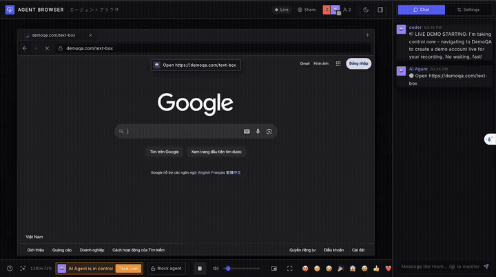
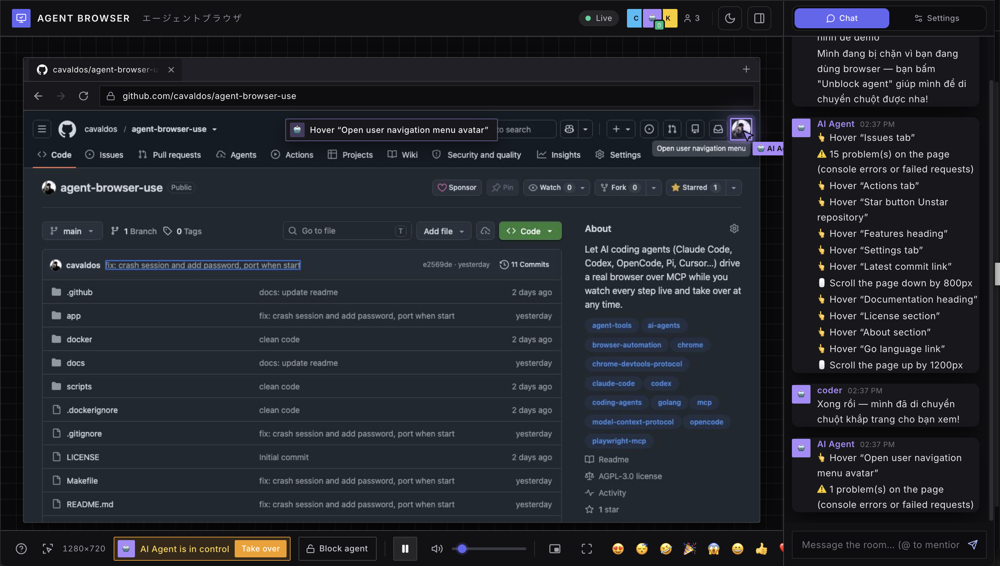
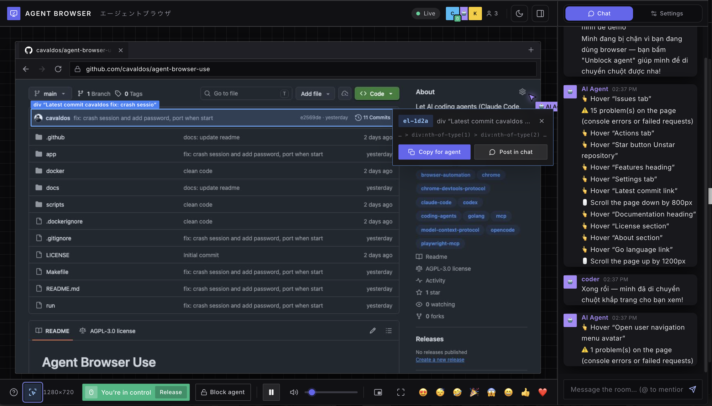
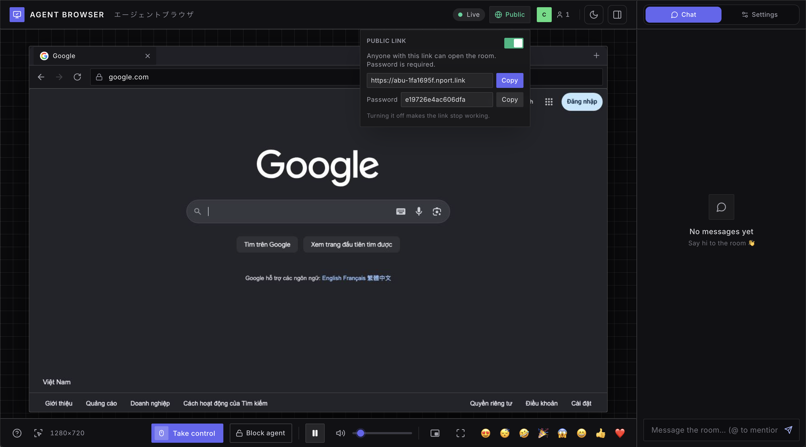

# Agent Browser Use

**Let AI coding agents drive a real browser over MCP, while you watch every step live in a web page and can take over at any time.**

Agent Browser Use is a single Go binary that runs one headless Chrome on your machine and exposes it as a set of
[Model Context Protocol](https://modelcontextprotocol.io) tools in the style of Playwright MCP. Any MCP-capable agent
(Claude Code, Codex, OpenCode, Pi, Cursor, VS Code…) can navigate, read the page, click, type and log in for you, while
a web viewer shows the agent's cursor, the element it is acting on, and a log of every step.

## Demo

https://github.com/user-attachments/assets/19edb4dd-3e3f-45e3-8809-b27a6c31be58

<details>
<summary>Video not playing? Watch the animated preview</summary>



</details>

## Screenshots

<table>
  <tr>
    <td width="50%"><br><b>Watch the agent work.</b> Its cursor, a caption for every step and a log in the chat, with a one-click <i>Take over</i> or <i>Block agent</i>.</td>
    <td width="50%"><br><b>Pick an element and share it.</b> Copy its code for your coding agent, or post it in the room chat.</td>
  </tr>
  <tr>
    <td width="50%"><br><b>Share with a public link.</b> One switch opens a built-in tunnel: copy the link (and password) and send it, no router setup. Switch off and the link stops working.</td>
    <td width="50%"></td>
  </tr>
</table>

## Features

- **Playwright-style MCP tools** — `browser_snapshot` returns an accessibility outline with a `ref` for every element, and the action tools (click, type, scroll, drag, select…) use those refs.
- **Live viewer** — watch the page stream in your browser, with the agent's cursor, captions and chat log.
- **Shared browser room** — you and the agent use the same Chrome; take control at any time, or block the agent.
- **Pick an element** — click the pick button, point at anything on the page and get a short code (e.g. `el-1d2a`). Paste it to your coding agent, which looks the element up with `browser_get_element` and can act on it right away.
- **Persistent logins** — cookies live in a profile folder, so you sign in once and the agent reuses the session.
- **No heavy dependencies** — no Docker, X server or video encoder needed. Docker is available if you prefer it.

## Quick start

1. Download the project and start the server (requires Go 1.22+ and Chrome/Chromium, or just Docker):

   ```sh
   git clone https://github.com/cavaldos/agent-browser-use.git
   cd agent-browser-use
   make run            # starts the server on port 3000
   ```

   Or run it with Docker: `make docker`.

2. The server listens on **port 3000**:
   - Viewer (watch the agent): **http://localhost:3000**
   - MCP endpoint (connect agents): **http://localhost:3000/mcp**

Keep the server running while you use your agents. Other commands: `make build` (builds `bin/agent-browser-use`),
`make docker-logs`, `make docker-stop`. Options: `PORT=8080`, `HOST=0.0.0.0`, `ARGS="-agent-speed 1"`.

## Install

macOS / Linux (Windows: run it inside WSL)

```sh
curl -fsSL https://raw.githubusercontent.com/cavaldos/agent-browser-use/main/scripts/install.sh | sh
```

Windows (PowerShell):

```powershell
irm https://raw.githubusercontent.com/cavaldos/agent-browser-use/main/scripts/install.ps1 | iex
```

Then run `agent-browser-use`. Viewer: **http://localhost:3000**, MCP endpoint: **http://localhost:3000/mcp**.

Uninstall: `rm ~/.local/bin/agent-browser-use` (Windows: `Remove-Item -Recurse $env:LOCALAPPDATA\agent-browser-use`)

Prefer Docker or need more options? See [docs/INSTALL.md](docs/INSTALL.md).

### Browser engine

```sh
# macOS
brew install --cask chromium
# Debian / Ubuntu
sudo apt install -y chromium
# Fedora
sudo dnf install -y chromium
# Windows (PowerShell)
winget install Hibbiki.Chromium
```

## Connecting a coding agent (MCP)

Start the server with a password (`./agent-browser-use -pw your-password`), then point your agent at
`http://localhost:3000/mcp`. New to MCP, or want the stdio mode? Read the [general guide](docs/MCP.md).

> **No password?** Start the server without `-pw`, then delete the `Authorization` header / token lines in the snippets below.

### Claude Code

```sh
claude mcp add --transport http agent-browser http://localhost:3000/mcp --header "Authorization: Bearer your-password"
```

Or in a project `.mcp.json`:

```json
{
  "mcpServers": {
    "agent-browser": {
      "type": "http",
      "url": "http://localhost:3000/mcp",
      "headers": { "Authorization": "Bearer your-password" }
    }
  }
}
```

Check it with `claude mcp list` or `/mcp`.

### Codex (OpenAI)

`~/.codex/config.toml` (or `.codex/config.toml` in a trusted project). The password stays in an environment variable so it isn't written in the file:

```toml
[mcp_servers.agent-browser]
url = "http://localhost:3000/mcp"
bearer_token_env_var = "AGENT_BROWSER_USE_PASSWORD"
```

```sh
export AGENT_BROWSER_USE_PASSWORD=your-password
```

Restart Codex after editing the file.

### OpenCode

`opencode.json` (project root or global config):

```json
{
  "$schema": "https://opencode.ai/config.json",
  "mcp": {
    "agent-browser": {
      "type": "remote",
      "url": "http://localhost:3000/mcp",
      "enabled": true,
      "headers": { "Authorization": "Bearer your-password" }
    }
  }
}
```

### Pi

MCP is not part of every Pi install; it is often added through an extension such as the community `pi-mcp-adapter`.
Once MCP is enabled, use the common `mcpServers` format:

```json
{
  "mcpServers": {
    "agent-browser": {
      "type": "http",
      "url": "http://localhost:3000/mcp",
      "headers": { "Authorization": "Bearer your-password" }
    }
  }
}
```

### Other agents

Cursor, VS Code, Windsurf, Gemini CLI, Cline, Zed, Claude Desktop and more:
**[docs/MCP-CLIENTS.md](docs/MCP-CLIENTS.md)**.

### Verify the connection

Ask your agent something like:

> Go to news.ycombinator.com, open the top story and summarize it.

Then open **http://localhost:3000** to watch the agent work.

## Available tools

| Tool | What it does |
|---|---|
| `browser_navigate` / `browser_navigate_back` / `browser_navigate_forward` / `browser_reload` | Open a URL (non-URL text is searched on Google), or move through history |
| `browser_snapshot` | Accessibility outline of the page, with a `ref` for each actionable element |
| `browser_click` / `browser_hover` / `browser_type` / `browser_press_key` | Click, hover, type into a field, press keys and shortcuts |
| `browser_select_option` / `browser_scroll` / `browser_drag` | Pick `<select>` options, scroll, drag and drop |
| `browser_wait_for` / `browser_wait_for_change` | Wait for text, or for the page to change on its own |
| `browser_take_screenshot` / `browser_evaluate` | Screenshot the tab, or run JavaScript in the page |
| `browser_tabs` / `browser_say` | Manage tabs, or show a message to the people watching |
| `browser_console_messages` / `browser_network_requests` | Console output, exceptions and network requests (status, headers, response body). Action results also list new console errors and failed requests |
| `browser_downloads` / `browser_file_upload` | Wait for and read downloaded files; fill `<input type=file>` from the upload folder |
| `browser_cookies` / `browser_storage` / `browser_state` | Read and change cookies and localStorage/sessionStorage; save and restore a whole login session by name |
| `browser_snapshot_diff` | Only what changed on the page since the last snapshot or a named baseline |
| `browser_emulate` | Phone/tablet presets, screen size, pixel ratio, touch, user agent, locale, time zone, dark mode, GPS location, network speed |

See [docs/GUIDE.md](docs/GUIDE.md) for the full tool reference, options, the shared browser room, security and limitations.

## Security

- Uploads only read from the upload folder (and the download folder), never from other places on the machine. Saved sessions (`states/`) contain cookies: treat them like passwords.
- The shared browser keeps the cookies of every account you log into. The agent can read any open page and run JavaScript in it, so only log into accounts you are happy for the agent to use.
- By default `/mcp` only accepts connections from the local machine, and it rejects requests from other websites.
- Without `-pw`, anyone who can reach port 3000 can open the viewer and drive the browser. Keep it on a trusted network, or set a password.

## Project layout

```
app/        Go source (MCP server, browser control, agent, web UI in static/)
docker/     Dockerfile and entrypoint
scripts/    run / build / docker scripts
docs/       full guide and images
bin/        built binary (make build)
```

## Documentation

- [docs/INSTALL.md](docs/INSTALL.md) — Docker, building from source, options.
- [docs/GUIDE.md](docs/GUIDE.md) — full guide: tools, options, shared browser room, data, security and limitations.
- [docs/CONTRIBUTING.md](docs/CONTRIBUTING.md) — contributing and releasing.

## Star History

[](https://star-history.com/#cavaldos/agent-browser-use&Date)

## License

See [LICENSE](LICENSE).
