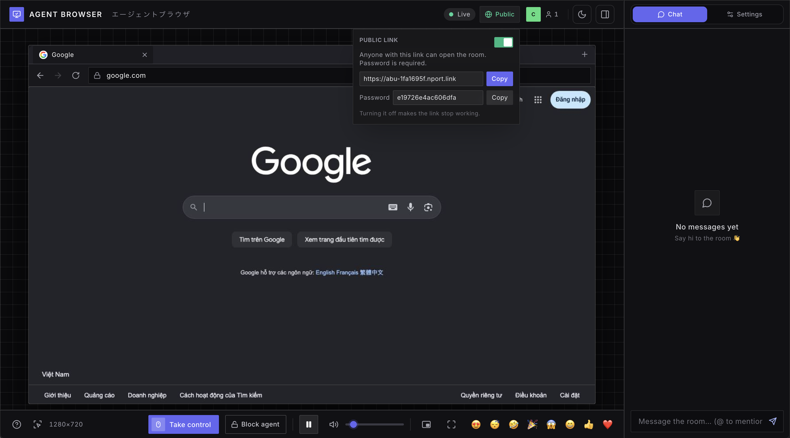
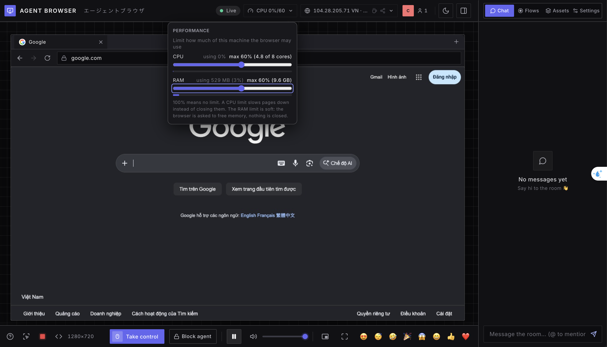

# Agent Browser Use

**Let AI coding agents drive a real browser over MCP, while you watch every step live in a web page and can take over at any time.**

Agent Browser Use is a single native binary (Rust) that runs one headless Chrome on your machine and exposes it as a set of
[Model Context Protocol](https://modelcontextprotocol.io) tools in the style of Playwright MCP. Any MCP-capable agent
(Claude Code, Codex, OpenCode, Pi, Cursor, VS Code…) can navigate, read the page, click, type and log in for you, while
a web viewer shows the agent's cursor, the element it is acting on, and a log of every step.

<p align="center">
  <a href="https://github.com/cavaldos/agent-browser-use/releases/latest"></a>
  <a href="https://github.com/cavaldos/agent-browser-use/releases"></a>
  <a href="https://github.com/cavaldos/agent-browser-use/stargazers"></a>
  <a href="https://github.com/cavaldos/agent-browser-use/network/members"></a>
  <a href="LICENSE"></a>
  <a href="https://github.com/sponsors/cavaldos"></a>
</p>

## Demo

https://github.com/user-attachments/assets/19edb4dd-3e3f-45e3-8809-b27a6c31be58

<details>
<summary>Video not playing? Watch the animated preview</summary>


</details>

## Screenshots

<table>
  <tr>
    <td width="50%"><br><b>Watch the agent work.</b> Its cursor, a caption for every step and a log in the chat, with a one-click <i>Take over</i> or <i>Block agent</i>.</td>
    <td width="50%"><br><b>Pick an element and share it.</b> Copy its code for your coding agent, or post it in the room chat.</td>
  </tr>
  <tr>
    <td width="50%"><br><b>Share with a public link.</b> One switch opens a built-in tunnel: copy the link (and password) and send it, no router setup. Switch off and the link stops working.</td>
    <td width="50%"><br><b>Resource management.</b> Keep track of all the resources you create and use in your browser sessions.</td>
    
    <td width="50%"></td>
  </tr>
</table>

## Features

| Feature                        | Description                                                                                                                                                               |
| ------------------------------ | ------------------------------------------------------------------------------------------------------------------------------------------------------------------------- |
| **Playwright-style MCP tools** | `browser_snapshot` returns an accessibility outline with a `ref` per element; action tools (click, type, scroll, drag, select…) use those refs.                           |
| **Live viewer**                | Watch the page stream with the agent's cursor, captions and chat log.                                                                                                     |
| **Shared browser room**        | You and the agent share one Chrome; take control or block the agent anytime.                                                                                              |
| **Pick an element**            | Pick button → short code (e.g. `el-1d2a`); agent looks it up via `browser_get_element` and acts on it.                                                                    |
| **Record a flow**              | Record a task → flow id (e.g. `flow-3fa9c1`); replay via `browser_run_flow` (repeat N×, override `inputs`). Flows tab to view/edit/rename/export. Passwords never stored. |
| **Assets tab**                 | Screenshots, copied text, picked elements and downloads kept in sidebar; view/copy/download/remove. Survive restart (`assets` folder).                                    |
| **Inspect (DevTools)**         | `</>` button docks Chrome DevTools under the screen; works behind password/public link. `-no-devtools` keeps debug port closed.                                           |
| **Persistent logins**          | Cookies in a profile folder; sign in once, agent reuses the session.                                                                                                      |
| **No heavy dependencies**      | No Docker, X server or video encoder. Docker optional.                                                                                                                    |

## Quick start

1. Install the binary (see [Install](#install), no Rust needed) and run `agent-browser-use`, or run from source
   (requires a Rust toolchain and Chrome/Chromium, or just Docker):

   ```sh
   git clone https://github.com/cavaldos/agent-browser-use.git
   cd agent-browser-use
   make run            # starts the server on port 3000
   ```

   Or run it with Docker: `make docker`. If you installed the binary (see [Install](#install)), just run `agent-browser-use`.

2. The server listens on **port 3000**:
   - Viewer (watch the agent): **http://localhost:3000**
   - MCP endpoint (connect agents): **http://localhost:3000/mcp**

Keep the server running while you use your agents.

### Run commands

```sh
agent-browser-use                       # web UI + MCP over HTTP (port 3000)
agent-browser-use -p 8080 -pw secret    # other port, with a password
agent-browser-use mcp                   # MCP over stdio (an agent starts it for you); also serves the web UI
agent-browser-use -version              # print the version
agent-browser-use -update               # update to the latest release
```

From source, use `make`:

| Command | What it does |
|---|---|
| `make run` | Run from source. Short options: `make run p=8080 pw=secret engine=brave` |
| `make run -- -p 8080 -pw secret` | Pass any flag straight to the app |
| `make build` | Build `bin/agent-browser-use` |
| `make test-release` | Dry-run the release pipeline locally (`ARGS=--quick` for a fast check) |
| `make release V=v1.2.3` | Tag and push a release (maintainers; runs fmt, clippy, tests first) |
| `make install` | Build and install to `~/.local/bin` (`BINDIR=...` to change) |
| `make docker` / `make docker-logs` / `make docker-stop` | Run in Docker, show its logs, stop it |
| `make docker-warp` | Docker with a Cloudflare WARP container as the browser's proxy |

`PORT=8080`, `HOST=0.0.0.0` and `ARGS="-agent-speed 1"` also work with `make`.

### Flags

| Flag | Default | Meaning |
|---|---|---|
| `-port`, `-p` | `3000` | HTTP port |
| `-pw` | none | Password for the web UI and `/mcp` (or env `AGENT_BROWSER_USE_PASSWORD`) |
| `-home` | `~/.config/agent-browser-use` | The one folder where everything is stored (see below; or env `AGENT_BROWSER_USE_HOME`) |
| `-engine` | `auto` | `chromium`, `chrome`, `edge`, `brave`, `vivaldi`, `headless-shell` (lightest), `obscura` (experimental, never chosen by `auto`) |
| `-chrome` | auto-detect | Path to the browser executable |
| `-install-extension` | none | Open a Chrome Web Store detail link or extension ID for manual installation, then exit |
| `-enable-extensions` | off | Run the shared Google Chrome with its installed extensions enabled |
| `-cdp-url` | none | Connect to an already running [Obscura](https://github.com/h4ckf0r0day/obscura) (`ws://127.0.0.1:9222`) instead of starting a browser |
| `-width`, `-height` | `1280`, `720` | Shared screen size |
| `-quality` | `92` | Image quality 10-100 (lower = less bandwidth) |
| `-max-tabs` | `12` | Maximum open tabs |
| `-start` | `https://www.google.com` | Page for new tabs |
| `-agent-speed` | `0` | Agent cursor/typing pace: `0` instant, `1` normal, `2` slower |
| `-agent-idle` | `15s` | Give control back after the agent is idle this long (`0` = never) |
| `-open` | `true` | Open the viewer when the agent starts and nobody is watching |
| `-proxy` | none | Upstream SOCKS5 proxy for the browser only (or env `AGENT_BROWSER_USE_PROXY`) |
| `-tunnel` | off | Public https link through a built-in Cloudflare tunnel (sets a password if none) |
| `-subdomain` | random | With `-tunnel`: name for the public URL |
| `-mcp-remote` | off | Allow `/mcp` from other machines (default: this machine only) |
| `-no-mcp` | off | Disable the `/mcp` endpoint |
| `-no-browser` | off | Disable the shared browser |
| `-no-audio` | off | Disable browser audio |
| `-data` | none | File to keep chat history across restarts (default: memory only) |
| `-profile`, `-downloads`, `-uploads`, `-states`, `-flows` | inside `-home` | Override where one specific part is stored |

Run `agent-browser-use -h` for the full list. Set `AGENT_BROWSER_USE_NO_MENU=1` to run in the foreground instead of the terminal menu.

### Chrome Web Store extensions

**From the local viewer on macOS:** With Google Chrome as the shared browser, open `http://localhost:3000` (or your configured port) and paste a Chrome Web Store listing link into the viewer's address bar. Press Enter to open the install dialog. If the listing is already open in a regular viewer tab, choose **Install in viewer** under the address bar. You can also use the puzzle-piece button beside the address bar to enter a link or ID. Click **Open Chrome Web Store** to start the session. Click **Add to Chrome** in the preview and review the real Chrome permission dialog there. Choose **Return and enable extensions** after installing to keep extensions enabled for that profile. No CLI flags are needed.

To see installed extensions (including disabled ones), click the puzzle-piece button and choose **Manage installed extensions**. Scroll the Chrome preview, click **Remove** beside an extension, and confirm in Chrome. Use **Return to viewer** when finished; this does not undo changes.

Save your work first: starting either action restarts the shared browser and closes its open tabs. macOS must allow Screen Recording and Accessibility for Agent Browser Use (or the app that launched it). The preview is only available over localhost, never through the public tunnel. Chrome's extension toolbar popups are not part of the regular tab viewer after installation.

**CLI fallback:** The Web Store's install button can keep spinning in a regular headless viewer tab. To use a separate Chrome window instead, **stop the Agent Browser Use process first** (`Ctrl+C` or **Quit** in the menu), then run:

```sh
agent-browser-use -install-extension '<Chrome Web Store detail URL or extension ID>'
```

In the Chrome window that opens, review the permissions and click **Add to Chrome**. Check `chrome://extensions` in that same window, then quit Chrome (on macOS, use **⌘Q**). The command opens Chrome for setup only; it does not start the web viewer or MCP server, and it cannot tell whether you accepted the install. Then start the headless browser with:

```sh
agent-browser-use -enable-extensions
```

Both flags select Google Chrome instead of `auto`, and both commands must use the same `-home` and `-profile` overrides, if any. For `agent-browser-use mcp -enable-extensions`, add `-home "$HOME/.agent-browser-use"` to the install command if you're using the default MCP home on macOS or Linux; otherwise pass the same explicit `-home` to both commands.

**Linux VPS:** The in-viewer installer is macOS-only. For the CLI fallback, run full Google Chrome on the VPS as a regular user and connect to its desktop over a private remote-desktop connection (not a public VNC port). Install into the same profile that the agent will use, then start the agent with `-enable-extensions`. A headless-only VPS and the stock Chromium Docker image do not support this Web Store installation flow.

Install only extensions you trust: they can access the shared browser's pages or data according to the permissions you grant. A wallet extension may expose a provider to a site, but the viewer cannot reliably show its unlock, connection, or signing popups. Use a trusted local browser or the site's mobile-wallet option where available. Do not put wallet recovery phrases or private keys on the shared browser or VPS.

### Where your data goes

Everything the app creates lives in **one folder**, `~/.config/agent-browser-use/`, created on first start. Change it with `-home <folder>`. With `agent-browser-use mcp` (started by an agent from any folder) it is `~/.agent-browser-use/` instead.

```
~/.config/agent-browser-use/
  chrome-profile/        browser cookies and logins (delete it to log out of everything)
  downloads/             files the browser downloaded
  uploads/               files the agent may upload from
  states/                saved login sessions (contain cookies: treat like passwords)
  flows/                 recorded flows
  warp.json              built-in WARP account (private key, don't share)
  agent-browser-use.log  server log
```

**Own IP via Cloudflare WARP (browser only):** the globe chip in the header always shows the agent browser's public IP; its switch sends the browser through Cloudflare WARP. WARP runs inside the app (userspace WireGuard, no network interface, no route changes), so your computer keeps its own IP. The first time you switch it on, the app signs up a free WARP account and keeps it in `warp.json` in the home folder (private key, don't share it). To use your own SOCKS5 proxy instead, pass `-proxy socks5://host:port` (or `AGENT_BROWSER_USE_PROXY`); `make docker-warp` does that with a WARP container. DNS and WebRTC also go through the tunnel, so the real IP does not leak.

## Install

macOS / Linux

```sh
curl -fsSL https://raw.githubusercontent.com/cavaldos/agent-browser-use/main/scripts/install.sh | sh
```

Windows (PowerShell, installs the `.exe` into `%LOCALAPPDATA%\agent-browser-use`):

```powershell
irm https://raw.githubusercontent.com/cavaldos/agent-browser-use/main/scripts/install.ps1 | iex
```

Then run `agent-browser-use`. Viewer: **http://localhost:3000**, MCP endpoint: **http://localhost:3000/mcp**.

Uninstall: `rm ~/.local/bin/agent-browser-use` (Windows: `Remove-Item -Recurse $env:LOCALAPPDATA\agent-browser-use`)

Prefer Docker or need more options? See [docs/INSTALL.md](docs/INSTALL.md).

### Browser engine

```sh
# macOS
brew install --cask chromium
# Debian / Ubuntu
sudo apt install -y chromium
# Fedora
sudo dnf install -y chromium
# Windows (PowerShell)
winget install Hibbiki.Chromium
```

## Connecting a coding agent (MCP)

Start the server with a password (`./agent-browser-use -pw your-password`), then point your agent at
`http://localhost:3000/mcp`. New to MCP, or want the stdio mode? Read the [general guide](docs/MCP.md).

> **No password?** Start the server without `-pw`, then delete the `Authorization` header / token lines in the snippets below.

### Claude Code

```sh
claude mcp add --transport http agent-browser http://localhost:3000/mcp --header "Authorization: Bearer your-password"
```

Or in a project `.mcp.json`:

```json
{
  "mcpServers": {
    "agent-browser": {
      "type": "http",
      "url": "http://localhost:3000/mcp",
      "headers": { "Authorization": "Bearer your-password" }
    }
  }
}
```

Check it with `claude mcp list` or `/mcp`.

### Codex (OpenAI)

`~/.codex/config.toml` (or `.codex/config.toml` in a trusted project). The password stays in an environment variable so it isn't written in the file:

```toml
[mcp_servers.agent-browser]
url = "http://localhost:3000/mcp"
bearer_token_env_var = "AGENT_BROWSER_USE_PASSWORD"
```

```sh
export AGENT_BROWSER_USE_PASSWORD=your-password
```

Restart Codex after editing the file.

### OpenCode

`opencode.json` (project root or global config):

```json
{
  "$schema": "https://opencode.ai/config.json",
  "mcp": {
    "agent-browser": {
      "type": "remote",
      "url": "http://localhost:3000/mcp",
      "enabled": true,
      "headers": { "Authorization": "Bearer your-password" }
    }
  }
}
```

### Pi

MCP is not part of every Pi install; it is often added through an extension such as the community `pi-mcp-adapter`.
Once MCP is enabled, use the common `mcpServers` format:

```json
{
  "mcpServers": {
    "agent-browser": {
      "type": "http",
      "url": "http://localhost:3000/mcp",
      "headers": { "Authorization": "Bearer your-password" }
    }
  }
}
```

### Other agents

Cursor, VS Code, Windsurf, Gemini CLI, Cline, Zed, Claude Desktop and more:
**[docs/MCP-CLIENTS.md](docs/MCP-CLIENTS.md)**.

### Verify the connection

Ask your agent something like:

> Go to news.ycombinator.com, open the top story and summarize it.

Then open **http://localhost:3000** to watch the agent work.

## Available tools

See [docs/TOOLS.md](docs/TOOLS.md) for the list of MCP tools and recorded flows.

## Security

- Uploads only read from the upload folder (and the download folder), never from other places on the machine. Saved sessions (`states/`) contain cookies: treat them like passwords.
- The shared browser keeps the cookies of every account you log into. The agent can read any open page and run JavaScript in it, so only log into accounts you are happy for the agent to use.
- By default `/mcp` only accepts connections from the local machine, and it rejects requests from other websites.
- Without `-pw`, anyone who can reach port 3000 can open the viewer and drive the browser. Keep it on a trusted network, or set a password.

## Build and test

Requires stable Rust (rustup). The tunnel needs `cloudflared` embedded at build time: `scripts/fetch-cloudflared.sh` downloads it into `app/cloudflared/` (the release build does this for you).

```sh
make build                                  # bin/agent-browser-use
cd app && cargo fmt --check && cargo clippy --all-targets -- -D warnings && cargo test
```

CI (`.github/workflows/ci.yml`) runs the same checks on Linux and macOS. Pushing a tag `vX.Y.Z` (`make release V=vX.Y.Z`) builds and publishes binaries for macOS, Linux (arm64, amd64) and Windows (amd64).

## Project layout

See [docs/PROJECT-LAYOUT.md](docs/PROJECT-LAYOUT.md) for a detailed walkthrough of every
directory and module.

## Documentation

- [docs/INSTALL.md](docs/INSTALL.md) — Docker, building from source, options.
- [docs/GUIDE.md](docs/GUIDE.md) — full guide: tools, options, shared browser room, data, security and limitations.
- [docs/TOOLS.md](docs/TOOLS.md) — MCP tools and recorded flows.
- [docs/CONTRIBUTING.md](docs/CONTRIBUTING.md) — contributing and releasing.
- [docs/PROJECT-LAYOUT.md](docs/PROJECT-LAYOUT.md) — detailed map of directories and modules.

## MCP directories

- [Glama](https://glama.ai/mcp/servers/cavaldos/agent-browser-use)
- [Liqiwa MCP](https://mcp.liqiwa.com/s/cavaldos--agent-browser-use.html)
- [m8ven](https://m8ven.ai/mcp/cavaldos/agent-browser-use)
- [NicheDB](https://nichedb.dev/i/745594677)

## Star History

[](https://star-history.com/#cavaldos/agent-browser-use&Date)

## License

See [LICENSE](LICENSE).
